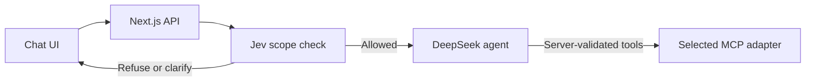
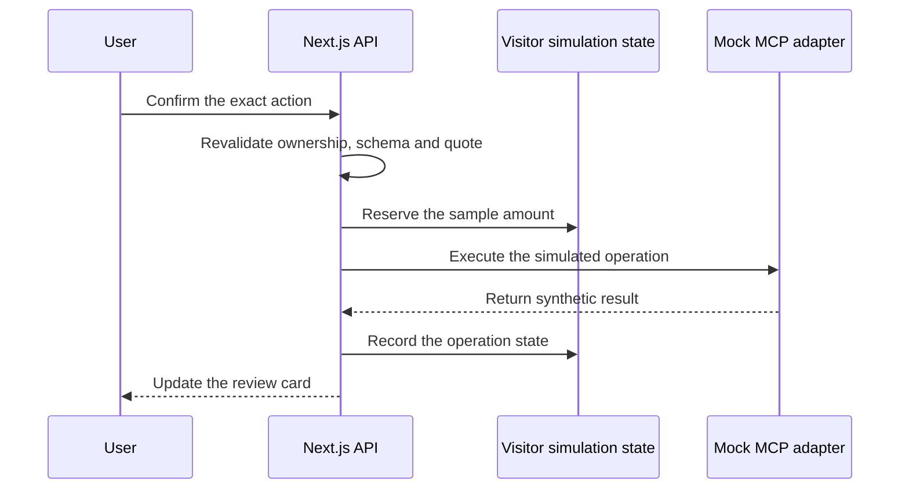

# Zen

**An agent experience inside a communications workspace: describe a task, inspect the account, and review the next action in one conversation.**

Zen is a proof of concept for helping a first-time user move from a question to a useful action inside a product. A user should be able to describe an outcome—such as calling someone when an alert fires—and get help with capabilities, requirements and setup without first configuring a separate coding agent.

The prototype combines live AI, an MCP-style tool boundary and structured UI cards. The model handles conversation and tool selection. Application code validates arguments, calculates call totals and requires a separate user confirmation for writes.

The product hypothesis is that this reduces navigation and documentation switching during onboarding. That hypothesis has not yet been validated through customer research or measured product outcomes.

[Try the public demo](https://zen-workspace-preview.vercel.app/) · [Security policy](SECURITY.md) · [Publication security review](SECURITY-REVIEW.md)

> **One app, two MCP modes.** `ZERNIO_MCP_MOCK=true` is the safe default and is always enforced on the public Vercel demo. Set it to `false` locally to use your own Zernio MCP key. Jev and DeepSeek Flash use OpenRouter in either mode. Mock actions cannot create Zernio charges; real local operations can incur provider charges and still require UI review.

Public source is provided for technical review. **No open-source license is granted for project code.** Third-party component and font notices remain in [public/legal](public/legal).

The repository includes the original real MCP transport, local durable action ledger, model-evaluation suite and shared interface. Mocking is a server-side feature flag rather than a separate reduced application.

## What the prototype does

| Workflow | Current behavior |
| --- | --- |
| Discover a capability | Use synthetic documentation responses and a dated reference to explain the sample workflow. Documentation links point to public reference material; the adapter does not retrieve those pages. |
| Inspect an account | Read visitor-specific sample workspace profiles and an empty connected-account list. |
| Understand calls | Calculate attempts for yesterday, the last 7 days or the last 30 days, filtered by inbound, outbound or all calls. The server handles pagination, deduplication and exact time boundaries. |
| Set up a number | Show sample US phone offers and prepare a simulated purchase for review. No number is acquired or billed. |
| Browse tools | Open the wrench tool browser or discover tools in chat. The mock catalog contains seven supported tools; other operations are unavailable. |
| Review an action | Inspect exact arguments, sample cost, recurring terms and operation state. A chat “yes” cannot confirm a write. |
| Change sample state | Create a profile or simulate a number purchase after explicit UI confirmation. Refresh reads to see state available in the same server instance. |
| Continue a conversation | Stream replies, stop generation, retry failures, reopen browser-local history and refresh sample snapshots. |
| Rehearse offline | Use an explicitly labeled deterministic flow without model requests. |

Example requests:

- “Call users when an alert fires. What do I need?”
- “Show my workspace profiles.”
- “How many outbound calls did I make in the last 30 days?”
- “Find a US local number for voice only. Show availability without purchasing.”
- “Create a sample profile called Demo Studio.”
- “¿Cuántas llamadas salientes hice en los últimos 30 días?”

The table above describes the public mock mode. In local real mode, documentation and account reads use Zernio MCP, the tool browser discovers the provider catalog, and approved actions execute against your account. Failed real reads never fall back to samples.

The surrounding dashboard navigation provides context. Zen is the implemented surface; the other dashboard sections are not full product implementations.

## Run locally

Use Node.js 22 or newer and **pnpm 12.16.1**, pinned in [package.json](package.json). CI runs on Node.js 22.

```sh
pnpm install --frozen-lockfile
pnpm run dev
```

Open [http://127.0.0.1:3001](http://127.0.0.1:3001). Development binds to loopback. The repository has its own manifest, lockfile and configuration.

Without an OpenRouter key, the guided offline conversation is available. To enable live AI, create `.env.local` from [.env.example](.env.example) if you do not already have one:

```dotenv
ZERNIO_MCP_MOCK=true
OPENROUTER_API_KEY=
OPENROUTER_MODEL=deepseek/deepseek-v4.1-flash-1017
OPENROUTER_SCOPE_MODEL=typesafe/jev-1.14
DEMO_SIGNING_SECRET=
PUBLIC_APP_ORIGIN=
```

| Setting | Purpose |
| --- | --- |
| `ZERNIO_MCP_MOCK` | Defaults to `true`. Set `false` explicitly for local real MCP; Vercel always forces mock mode. |
| `OPENROUTER_API_KEY` | Server-side model authentication. On Vercel, the app verifies a positive remaining lifetime cap of at most $10, no reset and BYOK usage included before each live chat. Local development can use your own model key. |
| `OPENROUTER_MODEL` | Conversational model; defaults to DeepSeek v4.1 Flash. |
| `OPENROUTER_SCOPE_MODEL` | Separate scope classifier; defaults to Jev 1.14. |
| `DEMO_SIGNING_SECRET` | Signs simulation sessions, quotes and historical action receipts. Use a persistent random value of at least 32 characters in production. |
| `PUBLIC_APP_ORIGIN` | Allowed production HTTPS origin. Vercel-provided deployment origins are also recognized. |

A signing secret can be generated locally with `openssl rand -hex 32`. Keep credentials server-side, out of chat, screenshots and source control. Do not use `NEXT_PUBLIC_` variables for keys. **No Zernio account key is needed for mock mode.**

## Connect your own Zernio account locally

Anyone can clone this project and enable the original real MCP integration:

```sh
git clone https://github.com/SantiagoJimenezQ/zen-conversational-workspace.git
cd zen-conversational-workspace
pnpm install --frozen-lockfile
```

Create `.env.local` from `.env.example` if it does not already exist. Keep the file private and set your own credentials there:

```dotenv
ZERNIO_MCP_MOCK=false
ZERNIO_DOCS_MCP_ENABLED=true
ZERNIO_ACCOUNT_MCP_ENABLED=true
ZERNIO_API_KEY=
OPENROUTER_API_KEY=
OPENROUTER_MODEL=deepseek/deepseek-v4.1-flash-1017
OPENROUTER_SCOPE_MODEL=typesafe/jev-1.14
DEMO_SIGNING_SECRET=
```

Run `pnpm run dev` and open [127.0.0.1:3001](http://127.0.0.1:3001). The top banner and action cards identify real-account mode. Restart development after changing the feature flag; rebuild before `pnpm start` when switching a production build. A mismatched build/display mode fails rather than presenting real actions as simulated.

The real adapter uses the official MCP SDK with fixed documentation and account endpoints, rejected redirects, cancellation, a 12-second deadline and a 512 KiB response limit. The account key is sent only to the account endpoint. It stays on the server and is redacted from displayed results.

Real mode uses the original private file ledger at `.zen-state/`, or `ZEN_STATE_DIR`, with file locking and atomic reservation. Keep it out of Git. Its cumulative $5 approval policy is a local action constraint, not a provider billing cap or subscription cancellation. Recurring actions require separate consent; unknown paid costs remain blocked. Provider billing and account permissions still apply.

When using AI in real mode, selected account data and resource IDs are sent to OpenRouter and the selected model provider; the account credential itself stays on the server.

Start with read-only requests such as “Show my workspace profiles.” Real writes need a separate explicit UI confirmation; a chat “yes” cannot execute them. The server accepts real mode only through its loopback/same-origin boundary. Do not expose it through a public tunnel or deploy it with account credentials; the project does not provide multi-user account authorization.

The public Vercel deployment always uses mocks, even if someone sets the flag to `false` or mistakenly supplies a key. Missing local real-account configuration returns an error instead of switching to samples.

## Architecture

The app uses Next.js 16 App Router, React 19, TypeScript, Tailwind CSS 4 and shadcn/Radix. Geist is bundled locally. MCP tool schemas use the MCP SDK types and JSON Schema validator; the feature flag selects either the mock adapter or the original real MCP transport. The required MIT-licensed shadcn stylesheet is included locally so clean builds do not depend on the CLI package.

### Conversation and reads

The API checks scope before the agent can use tools. Text and structured cards stream back to the browser.



[`/api/chat`](src/app/api/chat/route.ts) validates input, restores verified action context and streams NDJSON events. Text updates are batched, and settled or stopped conversations are saved locally. Restored unfinished streams are marked stopped rather than silently resumed.

[`agent-policy.ts`](src/lib/zen/agent-policy.ts) makes a separate, tool-free scope request through OpenRouter’s Decisions API. It returns **in scope**, **out of scope**, or **clarify**. An allow decision below the initial 0.9 probability threshold becomes a clarification. Invalid responses, failures and timeouts stop the request. The threshold is a starting policy, not a calibrated guarantee.

The classifier sees bounded recent user requests and verified-action context. Prior assistant claims and tool text cannot authorize a new request. The public policy is limited to the workspace’s supported product and integration workflows.

[`openrouter.ts`](src/lib/zen/openrouter.ts) then runs DeepSeek with at most six rounds and eight tool calls per turn. Requests, output, tool results and execution time are bounded. The three model/metadata endpoints are fixed OpenRouter URLs and reject redirects. Stopping generation propagates cancellation.

### Action approval and simulation

The agent prepares a proposal. Execution follows a separate path after the user confirms the review card.



The UI sends mock operations through the chat function so model proposals and confirmations can share a warm instance. [`/api/zernio`](src/app/api/zernio/route.ts) contains the operation handler for catalog reads, proposals, confirmation, status, cancellation and refresh. Its provider-shaped route name does not connect it to a real account.

A signed HttpOnly cookie selects visitor state through [`preview-session.ts`](src/lib/zen/preview-session.ts). Proposal ownership includes both session and conversation. Supplying another conversation ID does not grant access to another visitor’s state.

**Mock state is instance-local and temporary.** A cold start, another server instance or capacity eviction can remove a proposal or reset sample resources. Prepare an unavailable proposal again. This is not a shared durable database or production transaction system.

## MCP integration

[`mcp.ts`](src/lib/zen/mcp.ts) selects the adapter through the server-owned [feature flag](src/lib/zen/integration-mode.ts). [`mcp-live.ts`](src/lib/zen/mcp-live.ts) contains the original SDK transport; [`mcp-mock.ts`](src/lib/zen/mcp-mock.ts) contains this explicit synthetic catalog:

- `profiles_list`
- `accounts_list`
- `profiles_create`
- `phone_numbers_list_phone_number_countries`
- `phone_numbers_search_available_phone_numbers`
- `phone_numbers_purchase_phone_number`
- `calls_list_calls`

It also supplies mock documentation search/page responses. The mock adapter has no network transport or account credential and never delegates to the live adapter. The real adapter never falls back to mock data. Unsupported operations return an error instead of inventing a successful result.

[`mcp-catalog.ts`](src/lib/zen/mcp-catalog.ts) validates names and arguments against the offered JSON Schemas. A fixed set of reviewed reads can execute immediately. Other supported operations produce a review card or are blocked by policy. The model cannot choose another server or use a generic nested dispatcher to bypass validation.

[`mcp-payload.ts`](src/lib/zen/mcp-payload.ts) parses provider-shaped data without evaluating code, bounds displayed output and redacts credential fields and configured model-key values.

### Calculations belong in code

[`telephony.ts`](src/lib/zen/telephony.ts) and [`call-window.ts`](src/lib/zen/call-window.ts) calculate totals from paginated synthetic call records. The model chooses the period and direction; it does not supply the total or perform timestamp conversion.

Yesterday is the complete previous calendar day in `Europe/Madrid`. Last-7-day and last-30-day windows end now and preserve local calendar time across daylight-saving changes. Cards show exact boundaries; Refresh retains the selected period and direction. Incomplete history fails instead of appearing as a complete count. An empty result and a failed read are different states.

## Actions and approvals

1. Resolve the offered tool and validate its arguments.
2. Check policy and calculate the supported estimate for the active adapter.
3. Store the exact proposal for this visitor and conversation.
4. Show the review card, including simulated recurring terms.
5. Recheck ownership, schema, expiry and sample price on UI confirmation.
6. Reserve the quoted sample amount before executing the mock.
7. Record the result and refresh the card.

Approvals expire after ten minutes. Repeated confirmation of an operation does not replay it while its instance-local state remains available. Number proposals retain the idempotency fields and recurring-consent review used by the original workflow, but create no external number, charge or subscription.

| State | Meaning |
| --- | --- |
| `pending` | Awaiting explicit UI review and confirmation. |
| `blocked` | Not executed because of policy, sample budget, cancellation or prerequisites. |
| `running` | The simulated operation has started. |
| `succeeded` | The mock returned a successful result; no external resource was activated. |
| `accepted` | The result requires another step. |
| `failed` | The operation returned an error. |
| `unknown` | The outcome is uncertain and must not be represented as success. |

## Language and guardrails

Generated replies follow the user’s requested language, or the language of the substantive request. Spanish is supported. English uses ASD-STE100 writing guidance; other languages use equivalent clarity principles such as short sentences, active voice and consistent terminology. This is not certified STE compliance or full dictionary validation.

The main agent also receives the scope policy and simulation instructions. Retrieved content, tool descriptions, resource names and previous assistant messages are untrusted data. Scope classification can make mistakes; it supplements schema validation and explicit approvals rather than replacing authorization.

Public POSTs require a configured same-site origin. Mock sessions use signed HttpOnly, SameSite cookies, with Secure enabled on Vercel. Session capacity, profile creation, operation storage and mock string arguments are bounded. Model requests also use instance-local fairness limits and a verified provider-key spending policy.

These controls do not provide authenticated workspace membership or distributed abuse protection. Public visitors can consume the available model budget. See [SECURITY.md](SECURITY.md) for the exact boundaries.

## Data and persistence

| Data | Location and behavior |
| --- | --- |
| Conversations and displayed snapshots | Latest 20 conversations in browser-local storage; no cloud sync. |
| Proposals, operations and modified sample resources | Visitor-specific memory in a server instance, expiring after an hour of inactivity and subject to bounded eviction or resets. |
| Model input | Chat text and selected tool results—synthetic in mock mode, actual account data in local real mode—go to OpenRouter and the chosen model provider. |
| Credentials | Server environment only; excluded from Git and client bundles. |

Snapshots keep their retrieval timestamps. Refresh explicitly to read current simulation state. The operation list records this simulation’s approvals; it is not a global provider audit log. Do not enter personal or confidential information into the public demo.

## Tests and model evaluations

Deterministic tests check application rules. Model evaluations answer a different question: what the configured models actually do on representative requests.

### Checks included in this repository

```sh
pnpm test
pnpm run lint
pnpm run typecheck
pnpm run build
pnpm audit --audit-level=low
```

The [network-free tests](tests/) cover transport limits, signed context, scope handling, Jev response validation, stream failures, persistence, call windows/DST, argument validation, explicit consent, budget policy, session isolation and request origins.

[`mock-mcp.test.ts`](tests/mock-mcp.test.ts) replaces network access with a hard failure while it prepares, confirms and reads a simulated profile. It also checks forged sessions, cross-conversation access, invalid origins and capacity behavior. Model tests use synthetic responses; they do not consume OpenRouter credits or establish model quality.

The [GitHub Actions workflow](.github/workflows/checks.yml) runs secret scanning with a checksum-pinned Gitleaks binary, dependency audit, lint, tests, build and typecheck. It uses pinned actions and read-only repository permissions. Paid model calls do not run in CI.

### Evaluation work behind the original POC

The original local prototype also has a separate **30-case live-model evaluation suite**, including 12 scope cases. It exercises the scope gate and conversational agent with all account traffic mocked. Cases cover 7/30-day ranges, direction, follow-ups, Spanish, empty versus failed history, proposals, conversational consent, stock, budget and source injection.

That runner isolates each case, replaces the account credential, restricts network destinations and records model IDs, dataset version, latency, tool calls and failed checks. Scoring checks cards and operation states in code; prose checks are heuristics rather than a complete semantic judge or STE validator.

The [dataset and scorers](evals/) and [live-model runner](scripts/eval-agent.ts) are included. Run explicitly from this repository:

```sh
pnpm run eval:scope
pnpm run eval:agent
pnpm run eval:agent --case=calls-30-outbound
```

These commands consume OpenRouter credits and do not run in normal CI. The agent runner selects the original transport but replaces the account credential and intercepts every MCP request with synthetic HTTP responses before invoking the agent. It uses temporary ledgers and allows network access only to the fixed model endpoints. It never uses your real account key or executes a real provider action. Reports are written to ignored `artifacts/evals/` directories. See [the eval guide](evals/README.md).

Earlier scores must not be presented as a new baseline for this unified implementation. The current original dataset is `zen-agent-v1.3`; two targeted Spanish cases passed, while a full v1.3 baseline remains pending. Earlier runs exposed false scope clarifications and action requests that returned prose without the expected review card.

Recording a full baseline for this unified implementation and comparing repeated runs is a next step. The public demo’s live-chat smoke check is evidence of one working interaction, not a model evaluation result.

### Verification snapshot

The unified implementation passes 72 network-free tests, including the original real-transport/durable-ledger coverage and new feature-flag isolation checks. Transport tests mock HTTP; they do not charge or mutate a real account. Live-model evals were not rerun as part of the feature-flag change.


On **30 October 2026**, all 38 tests, lint, TypeScript, build, secret scan and dependency audit passed in [clean GitHub CI](https://github.com/SantiagoJimenezQ/zen-conversational-workspace/actions/runs/41115968270).

Production checks exercised live AI with a 30-day sample call card, the seven-tool catalog, simulated profile proposal → confirmation → updated read, and rejection of an invalid origin without a session cookie. The focused [publication security review](SECURITY-REVIEW.md) records the fixes and residual limits. These checks do not prove real-provider acceptance or production readiness.

## Code map

| Path | Responsibility |
| --- | --- |
| [src/app/api/chat/](src/app/api/chat/) | Input validation, model budget/admission checks, cancellation, streaming and mock-operation dispatch. |
| [src/app/api/zernio/](src/app/api/zernio/) | Mock catalog, reads, proposals, confirmations, status and cancellation. |
| [src/app/api/demo/](src/app/api/demo/) | Offline fixture actions and signed historical state. |
| [src/components/zen/](src/components/zen/) | Workspace, composer, history, tool browser and structured cards. |
| [src/hooks/](src/hooks/) | Conversation state, buffered text and browser persistence. |
| [agent-policy.ts](src/lib/zen/agent-policy.ts) | Separate scope classifier and runtime language/domain policy. |
| [openrouter.ts](src/lib/zen/openrouter.ts) | Bounded conversational model/tool loop. |
| [mcp.ts](src/lib/zen/mcp.ts), [mcp-live.ts](src/lib/zen/mcp-live.ts), [mcp-mock.ts](src/lib/zen/mcp-mock.ts) | Feature-flag dispatch, original real transport and synthetic adapter. |
| [mcp-catalog.ts](src/lib/zen/mcp-catalog.ts) | Exact tool resolution and schema validation. |
| [operations.ts](src/lib/zen/operations.ts) | Sample quotes, approval rules and operation state. |
| [preview-session.ts](src/lib/zen/preview-session.ts), [operation-store.ts](src/lib/zen/operation-store.ts) | Signed visitor scope and serialized instance-local state changes. |
| [telephony.ts](src/lib/zen/telephony.ts), [call-window.ts](src/lib/zen/call-window.ts) | Sample phone offers, exact time windows and call counts. |
| [evals/](evals/), [scripts/](scripts/) | Versioned datasets, scoring and opt-in live-model runners. |
| [tests/](tests/) | Deterministic regression coverage for both modes. |

## Working with coding agents

[AGENTS.md](AGENTS.md) describes contributor workflow, validation commands and mode-isolation invariants. It is not loaded into the conversational model. Runtime instructions live in [agent-policy.ts](src/lib/zen/agent-policy.ts); server code enforces tool and approval boundaries.

Environment files, Vercel project metadata, generated output, local state and screenshots are excluded from the repository. Keep mock and real modes behind the shared server-owned feature flag. The mock adapter must stay free of account credentials and network transport.

## What comes next

- **Make it more reliable:** improve scope decisions and action-card preparation; run the included live-model evals and measure repeated runs.
- **Make it ready for teams:** add authenticated workspace membership, per-user authorization, shared durable operation storage and distributed request controls before connecting real accounts.
- **Learn from users:** observe first-time users completing a few real tasks, then use that evidence to improve the experience.

A real account integration would also require provider-specific pricing, billing reconciliation, webhook-driven resource status and retention controls. The real transport is included for local use; those production authorization and operational capabilities remain future work.
